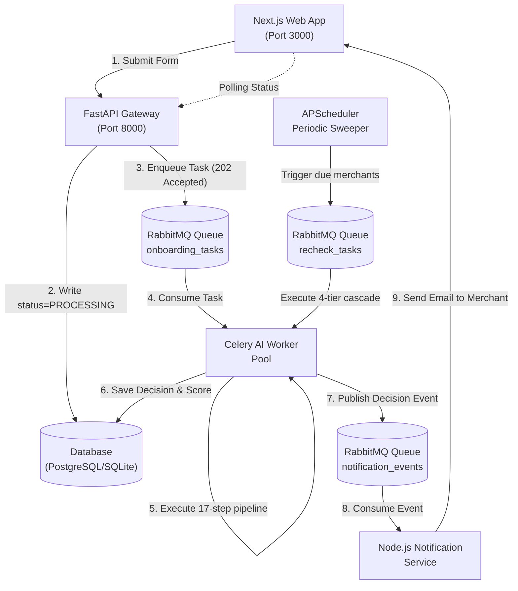
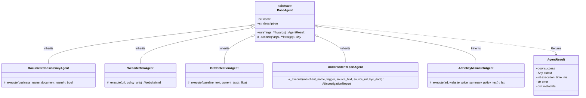
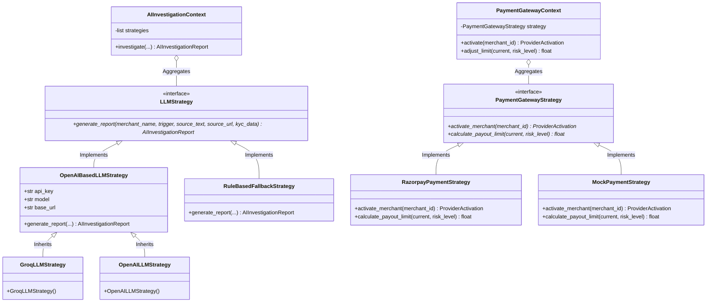
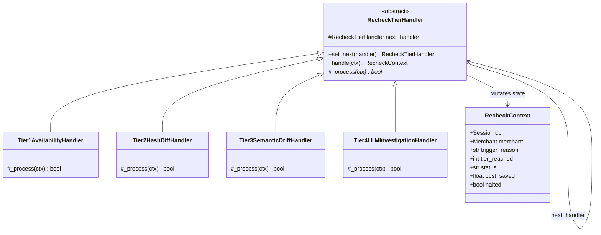
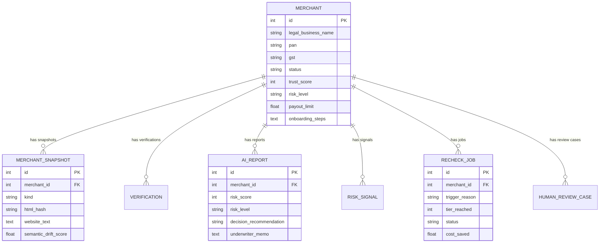
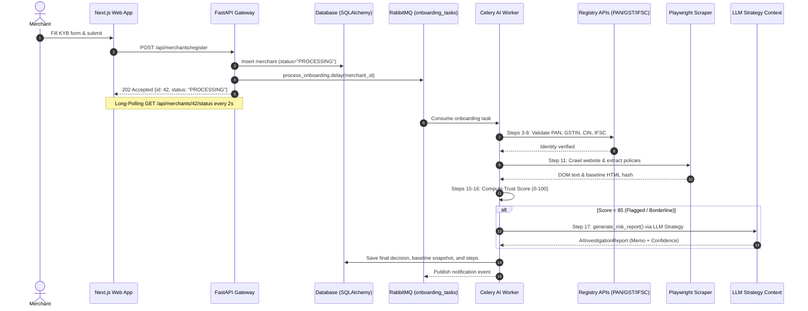
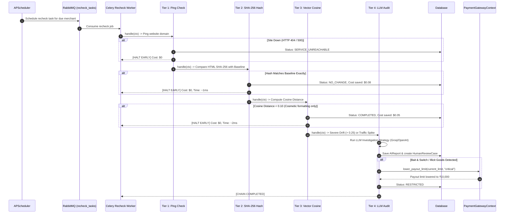
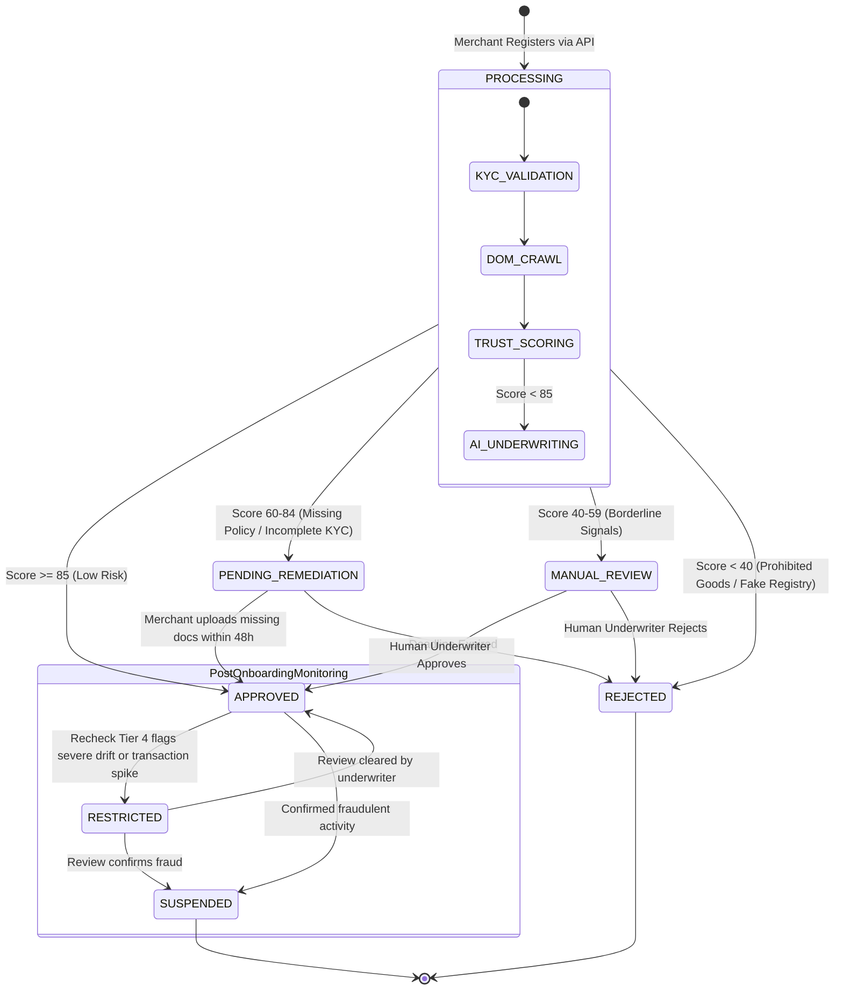

# SentinelPay: System Design & Object-Oriented Architecture Master Guide

> **Presentation & Interview Handbook**  
> **Project:** SentinelPay (Razorpay Autonomous Merchant Onboarding & Continuous Risk Agent)  
> **Target Audience:** System Design Evaluators, Technical Interviewers, and Project Reviewers  

---

## 1. Project Overview & 60-Second Elevator Pitch

### The Core Problem
In payment aggregators (like Razorpay, Stripe, or Cashfree):
1. **Day-0 Onboarding Latency:** Manual risk underwriting takes **3 to 5 business days**, causing high merchant drop-off.
2. **Day-N "Bait-and-Switch" Attacks:** Merchants get approved selling benign goods (e.g., clothing), then secretly pivot overnight to illegal goods (counterfeit items, drugs, gambling) or spoof payment checkouts.

### The SentinelPay Solution
SentinelPay solves both problems through an autonomous event-driven architecture:
- **Instant Day-0 Underwriting:** An automated 17-step asynchronous pipeline that cross-verifies government registries (PAN, GSTIN, CIN, Bank IFSC), crawls live websites with headless browsers (Playwright), and generates structured underwriter memos using LLMs (Groq LPU / OpenAI) in **under 30 seconds**.
- **Continuous 4-Tier Recheck Engine:** A cost-optimized **Chain-of-Responsibility** monitoring engine that short-circuits checks mathematically (HTTP Ping → SHA-256 Byte Diff → Vector Semantic Distance → LLM Deep Audit), auto-adjusting daily settlement payout limits to contain fraud without incurring runaway AI API bills.

---

## 2. High-Level Design (HLD) Architecture

### System Architecture Diagram (Text / ASCII View)

```text
┌─────────────────────────────────────────────────────────────────────────────┐
│                             CLIENT LAYER                                    │
│  Next.js 16 Web Dashboard (Merchant Registration & Admin Observability)     │
└──────────────────────────────────────┬──────────────────────────────────────┘
                                       │ HTTP POST /register (Payload)
                                       ▼
┌─────────────────────────────────────────────────────────────────────────────┐
│                          GATEWAY & INTAKE LAYER                             │
│  FastAPI REST Gateway (Port 8000)                                           │
│  - Validates payload with Pydantic                                          │
│  - Inserts Shell record into DB (status = 'PROCESSING')                     │
│  - Returns '202 Accepted' immediately to client                             │
└──────────────┬──────────────────────────────────────────────┬───────────────┘
               │ 1. Enqueue Task                              │ 2. Read/Write
               ▼                                              ▼
┌──────────────────────────────┐              ┌───────────────────────────────┐
│     MESSAGE BROKER           │              │      DATABASE LAYER           │
│  RabbitMQ (AMQP)             │              │  PostgreSQL / SQLite          │
│  - Queue: onboarding_tasks   │              │  (SQLAlchemy ORM)             │
│  - Queue: recheck_tasks      │              │  - merchants                  │
│  - Queue: notification_events│              │  - merchant_snapshots        │
└──────────────┬───────────────┘              │  - ai_reports & risk_signals  │
               │                              └───────────────▲───────────────┘
               │ Consume Tasks                                │
               ▼                                              │ Write Results
┌─────────────────────────────────────────────────────────────┴───────────────┐
│                       DISTRIBUTED WORKER LAYER                              │
│  Celery Distributed AI Workers (Python)                                     │
│                                                                             │
│  ┌───────────────────────┐  ┌───────────────────────┐  ┌─────────────────┐ │
│  │ 1. KYB Verification   │  │ 2. Web Intelligence   │  │ 3. AI Risk Memo │ │
│  │    PAN, GST, CIN,     │  │    Playwright Crawler,│  │    Groq LPU /   │ │
│  │    Bank IFSC Cross-Val│  │    DOM text extraction│  │    OpenAI GPT-4o│ │
│  └───────────────────────┘  └───────────────────────┘  └─────────────────┘ │
└──────────────┬──────────────────────────────────────────────────────────────┘
               │ Emit Decision Event
               ▼
┌─────────────────────────────────────────────────────────────────────────────┐
│                      NOTIFICATION MICROSERVICE                              │
│  Node.js Event Consumer (amqplib + Nodemailer)                              │
│  - Listens to 'notification_events' queue                                   │
│  - Compiles HTML templates and sends instant status alerts to merchant      │
└─────────────────────────────────────────────────────────────────────────────┘
```

### System Architecture Flowchart (Mermaid View)



---

## 3. Low-Level Design (LLD): Class Diagrams & OOP Architecture

To make the class structure clean and easy to read, the object-oriented design is broken down into **4 clear, modular sub-diagrams**.

---

### 3.1 Whiteboard Quick-Draw Reference

> [!TIP]
> **If the interviewer asks: "Can you draw the class diagram on the whiteboard?"**  
> Sketch this simple, clean 3-part box layout:
>
> ```text
> ┌──────────────────────────────────────────────┐
> │             <<abstract>> BaseAgent           │
> │  + name: str, description: str               │
> │  + run(*args): AgentResult   [Template Method]│
> │  # _execute(*args)*: Any                     │
> └───────────────────────▲──────────────────────┘
>                         │ inherits
>     ┌───────────────────┼───────────────────┐
>     │                   │                   │
> ┌───┴─────────────┐ ┌───┴─────────────┐ ┌───┴─────────────┐
> │ DocumentAgent   │ │ WebsiteRiskAgent│ │ DriftAgent      │
> └─────────────────┘ └─────────────────┘ └─────────────────┘
>
> ┌──────────────────────────────────────────────┐
> │           <<interface>> LLMStrategy          │
> │  + generate_report(prompt)*: AIReport        │
> └───────────────────────▲──────────────────────┘
>                         │ implements
>     ┌───────────────────┼───────────────────┐
>     │                   │                   │
> ┌───┴─────────────┐ ┌───┴─────────────┐ ┌───┴─────────────┐
> │ GroqLLMStrategy │ │ OpenAILLMStrategy│ │ RuleBasedFallback│
> └─────────────────┘ └─────────────────┘ └─────────────────┘
>
> ┌──────────────────────────────────────────────┐
> │        <<abstract>> RecheckTierHandler       │
> │  - next_handler: RecheckTierHandler          │
> │  + set_next(handler): RecheckTierHandler     │
> │  + handle(ctx: RecheckContext): RecheckCtx   │
> └───────────────────────▲──────────────────────┘
>                         │ implements (Chain of Resp.)
>     ┌───────────┬───────┴───────────┬───────────┐
>     ▼           ▼                   ▼           ▼
> ┌────────┐  ┌──────────┐      ┌───────────┐ ┌───────────┐
> │ Tier 1 │─►│  Tier 2  │─────►│  Tier 3   │─► Tier 4    │
> │ (Ping) │  │(SHA Hash)│      │(Cosine TF)│ │(LLM Audit)│
> └────────┘  └──────────┘      └───────────┘ └───────────┘
> ```

---

### 3.2 Diagram A: Agent Framework (Inheritance & Template Method Pattern)

Implemented in `backend/app/agents/base.py` and specialized agents.



- **Abstraction:** `BaseAgent` defines the abstract interface via `@abstractmethod def _execute()`.
- **Template Method Pattern:** `BaseAgent.run()` encapsulates invariant execution logic (timer start, exception handling, logging, metadata wrapping) while delegating variant logic to `_execute()`.

---

### 3.3 Diagram B: Strategy Pattern (LLM & Payment Gateway)

Implemented in `backend/app/services/ai_investigation_service.py` and `backend/app/services/payment_provider_service.py`.



- **Polymorphism:** `AIInvestigationContext` executes `strategy.generate_report(...)` uniformly without coupling to Groq, OpenAI, or the offline heuristic fallback.
- **Open-Closed Principle:** New payment providers (e.g. Stripe, PayU) can be added by implementing `PaymentGatewayStrategy` without modifying existing registration code.

---

### 3.4 Diagram C: Chain of Responsibility (4-Tier Continuous Recheck)

Implemented in `backend/app/services/recheck_chain.py` and `backend/app/services/recheck_orchestrator.py`.



---

### 3.5 Diagram D: Database Schema & Entity Relationships (ORM Layer)

Implemented in `backend/app/models/`.



---

## 4. UML Sequence Diagrams

### 4.1 Sequence Diagram: Day-0 Asynchronous Onboarding Flow



---

### 4.2 Sequence Diagram: 4-Tier Continuous Recheck (Bait & Switch Prevention)



---

## 5. State Machine Diagram: Merchant Lifecycle



---

## 6. Design Patterns Summary Table

| Pattern | Type | File Location | Purpose in SentinelPay |
| :--- | :--- | :--- | :--- |
| **Strategy Pattern** | Behavioral | `app/services/ai_investigation_service.py` | Encapsulates LLM invocation algorithms (`GroqLLMStrategy`, `OpenAILLMStrategy`, `RuleBasedFallbackStrategy`). Swaps models dynamically. |
| **Strategy Pattern** | Behavioral | `app/services/payment_provider_service.py` | Decouples payment processors (`RazorpayPaymentStrategy`, `MockPaymentStrategy`) from underwriting decisions. |
| **Strategy Pattern** | Behavioral | `app/services/risk_scoring_service.py` | Modular risk rule strategies (`KYCRuleStrategy`, `BankingRuleStrategy`, `CompliancePolicyRuleStrategy`). |
| **Chain of Responsibility** | Behavioral | `app/services/recheck_chain.py` | Cascades the 4-tier recheck sequentially. Each tier short-circuits early if no drift is found, saving >95% LLM API costs. |
| **Template Method** | Behavioral | `app/agents/base.py` | `BaseAgent.run()` enforces common timing, error handling, and telemetry, delegating business logic to abstract `_execute()`. |
| **Observer (Pub-Sub)** | Behavioral | `app/workers/pika_publisher.py` | Emits asynchronous AMQP events on RabbitMQ queues, consumed by the Node.js notification microservice. |
| **Facade Pattern** | Structural | `app/services/merchant_service.py` | Provides simple top-level functions (`create_merchant`, `run_recheck`) that hide complex multi-class orchestrations. |

---

## 7. OOP Pillars in SentinelPay

| OOP Pillar | Definition | How SentinelPay Demonstrates It (Code Reference) |
| :--- | :--- | :--- |
| **Abstraction** | Hiding complex internals behind clean interfaces. | `LLMStrategy(ABC)`, `BaseAgent(ABC)`, and `PaymentGatewayStrategy(ABC)` define contracts using `@abstractmethod`. Callers do not know low-level HTTP details. |
| **Inheritance** | Deriving child classes from a parent class to reuse code. | `GroqLLMStrategy` inherits from `OpenAIBasedLLMStrategy`, which inherits from `LLMStrategy`. All 5 agents inherit from `BaseAgent`. All database models inherit from `declarative_base()`. |
| **Polymorphism** | Calling the same method signature on different classes producing different behaviors. | Calling `strategy.generate_report(...)` dynamically invokes Groq's API, OpenAI's API, or the offline heuristic engine. Calling `handler.handle(ctx)` processes different tier logic through a uniform interface. |
| **Encapsulation** | Keeping data and mutating methods together while protecting state. | Dataclasses `RecheckContext`, `AgentResult`, and `ProviderActivation` encapsulate mutation state. Pydantic models validate and constrain fields before business logic executes. |

---

## 8. Top 5 System Design Interview Q&As

### Q1: Why did you choose an Asynchronous Architecture (FastAPI + Celery + RabbitMQ) over synchronous REST?
> **Answer:**  
> "A merchant verification pipeline involves external government registry lookups (MCA CIN, GSTIN portal), dynamic headless browser crawling with Playwright, and LLM text generation. If done synchronously in a single HTTP request:
> 1. The HTTP request would hang for 15–30 seconds, causing gateway timeouts (504 Gateway Timeout) and connection pool exhaustion.
> 2. By returning `202 Accepted` immediately and dispatching tasks to RabbitMQ, the FastAPI gateway handles thousands of requests per second with sub-10ms response times. The client polls status or receives an asynchronous webhook/email notification upon completion."

---

### Q2: What is the technical and economic justification for the 4-Tier Recheck Cascade?
> **Answer:**  
> "If a payment gateway monitors 100,000 active merchants daily using an LLM ($0.005 to $0.02 per crawl), the monthly AI bill alone would exceed $15,000 to $60,000.  
> In reality, 95% of active e-commerce merchants do not change their website policies or product catalog daily.  
> Our 4-Tier Cascade applies **mathematical short-circuiting**:
> - **Tier 1 (Availability Ping, ~100ms, $0):** Verifies the site is reachable.
> - **Tier 2 (SHA-256 Byte Hash, ~1ms, $0):** If not a single byte changed in the HTML DOM compared to baseline, it halts immediately. Filters out ~80% of checks.
> - **Tier 3 (Vector Cosine Distance, ~3ms, $0):** Calculates token frequency cosine distance. If distance < 0.10, the changes are cosmetic formatting. It halts immediately. Filters another ~15%.
> - **Tier 4 (LLM Deep Investigation, ~1500ms, ~$0.005):** Invoked **only for the remaining ~5%** of merchants where genuine semantic drift or fraud spikes occurred.  
> **Result:** >95% cost reduction and sub-millisecond execution for the vast majority of runs."

---

### Q3: How do you prevent LLM Hallucinations in Financial Underwriting?
> **Answer:**  
> "SentinelPay enforces a 4-layer guardrail system:
> 1. **Structured Outputs (Strict JSON Schema):** We use OpenAI/Groq JSON Schema mode (`strict: True`), constraining the LLM to output only typed JSON matching our Pydantic `AIInvestigationReport`.
> 2. **Deterministic Temperature:** Set `temperature=0.0` for repeatable, deterministic risk scoring.
> 3. **Exact Ground-Truth Quoting:** The prompt strictly requires that every high-risk claim copy an exact verbatim quote from the crawled text. In `ai_investigation_service.py`, a post-validation filter automatically discards any evidence quote that does not exist in the source document.
> 4. **Human-in-the-Loop Escalation:** The AI is never permitted to ban a merchant unilaterally; critical findings generate a `HumanReviewCase` for compliance officer sign-off."

---

### Q4: How do you handle Idempotency and Deduplication?
> **Answer:**  
> "1. In `create_merchant()`, before database insertion, deduplication queries check `legal_business_name`, `pan`, and `website_url`. If a duplicate is resubmitted, previous records are cleaned up or updated.  
> 2. RabbitMQ message tasks include merchant IDs; Celery workers use idempotent task boundaries so re-delivered messages do not create duplicate linked accounts in Razorpay."

---

### Q5: How would you scale this system to 1,000,000 merchants?
> **Answer:**  
> "1. **Database Partitioning:** Hash-partition `merchants` and `merchant_snapshots` tables by `merchant_id` across database shards.  
> 2. **Prioritized Queue Sharding:** Separate RabbitMQ queues into `onboarding_high_priority` (Day-0 instant applicants) and `recheck_batch_low_priority` (periodic monitoring).  
> 3. **Vector Database:** For Tier 3 semantic search across millions of snapshots, replace in-memory cosine math with a dedicated vector database (pgvector or Qdrant) with HNSW indexing.  
> 4. **Headless Browser Cluster:** Scale Playwright using a distributed browser grid (e.g. Browserless / Dockerized workers) with proxy rotation to prevent IP blocking."
